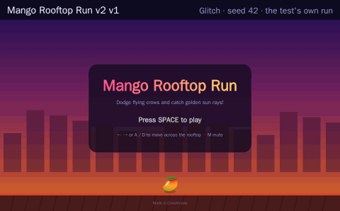
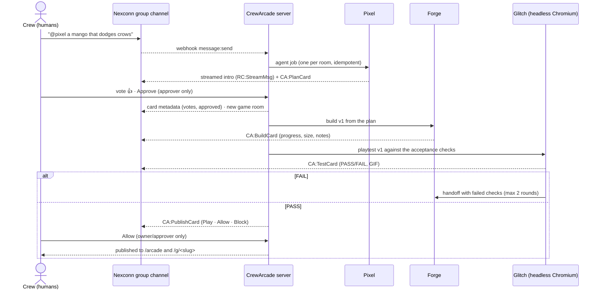
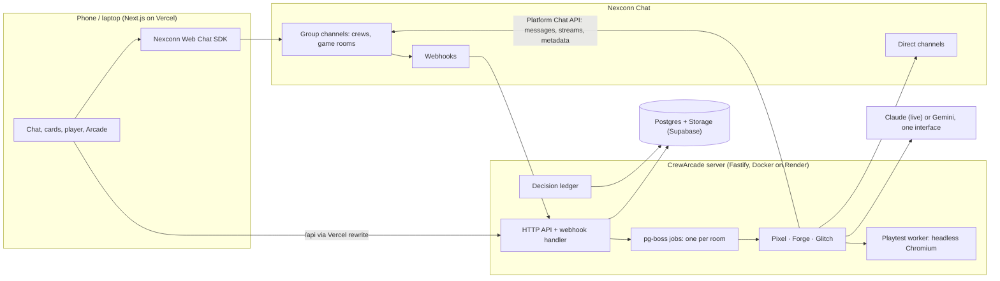

<div align="center">

# CrewArcade

**Your friends + 3 AI agents. One chat. A new game in minutes.**

Pitch a game idea in your group chat. Pixel plans it, Forge builds it, Glitch playtests it in a real
browser and records the proof. Nothing goes public until someone in your crew taps **Allow**.

[**Live app**](https://crewarcade.vercel.app) ·
[**Arcade**](https://crewarcade.vercel.app/arcade) ·
[**Live numbers**](https://crewarcade.vercel.app/impact) ·
[Try it in 3 minutes](#for-judges-try-it-in-3-minutes) ·
[Built on Nexconn](#built-on-nexconn) ·
[Real usage](#real-usage) ·
[Safety](#safety)


Nexconn Build Challenge 2026

</div>

<p align="center">
  
</p>
<p align="center"><sub>Glitch's own recording of a real playtest: <i>Mango Rooftop Run</i> v2, pitched in a live crew chat,
built by Forge, fixed once, playtested headlessly and published on 20 Nov 2026.</sub></p>

## Links

| What            | Where                                                                                                  |
| --------------- | ------------------------------------------------------------------------------------------------------ |
| Judge mode      | https://crewarcade.vercel.app/try (one tap, no sign-up, then a 23-step guided tour with Show me)       |
| Live app        | https://crewarcade.vercel.app (no password, no email)                                                  |
| Public Arcade   | https://crewarcade.vercel.app/arcade (games real crews made and published)                             |
| Live numbers    | https://crewarcade.vercel.app/impact (real people only, recomputed every minute, with raw JSON)        |
| Safety rules    | https://crewarcade.vercel.app/safety (what the shield blocks, publicly)                                |
| API health      | https://crewarcade-server.onrender.com/health                                                          |
| Demo video      | _TODO: YouTube link_                                                                                   |
| Write-up PDF    | _TODO: link_                                                                                           |
| Nexconn App Key | `TODO_APP_KEY` (public by design, Singapore data center)                                               |
| Source          | https://github.com/jatinvats123/crewarcade (default branch `main`, MIT)                                |
| Build log       | [`docs/STATUS.md`](docs/STATUS.md): every phase, what was verified live, and every bug found and fixed |

## For judges: try it in 3 minutes

One phone or laptop is enough. No sign-up form, no second device, no waiting list.

1. Open **https://crewarcade.vercel.app/try** (or tap **★ I'm a judge** on the home page or the sign-up
   screen) and tap **Start as a judge**. You land in your own crew
   chat with Pixel, Forge and Glitch. Three pitch ideas wait as chips above the message box (one in
   Hindi); nothing is typed for you, and your own idea works too. Judge accounts are marked and never
   counted in [our live numbers](https://crewarcade.vercel.app/impact).
2. **Follow the judge tour.** Judges (and only judges) get one card that walks through every feature:
   a bar at the bottom on a phone ("Core · step 3 of 6", tap it for the checklist), the checklist with
   progress in the right panel on a laptop. It starts with the **6-step core loop**, which you can
   finish in one sitting, then keeps going through **17 more steps in four Explore themes**, each with
   its own progress. Each step says what to press, what happens next and why it matters. **Show me**
   goes to the right page and puts a pulsing ring on the exact button (for the shield and Hindi steps
   it types the test message for you). Steps tick themselves from what really happens in the app;
   **Skip** is on every step, **Hide** tucks the tour into a small pill, and the last card lists what
   you skipped with links back. Progress is saved in this browser.

| #                               | Step                                                        | Ticks when                                   |
| ------------------------------- | ----------------------------------------------------------- | -------------------------------------------- |
| **Core loop**                   |                                                             |                                              |
| 1                               | Pitch a game                                                | Pixel's plan card appears                    |
| 2                               | Approve it                                                  | the plan is approved (a game room opens)     |
| 3                               | Watch Forge build (live agent chips)                        | the build is ready                           |
| 4                               | Glitch playtests it, with a GIF                             | the test card arrives                        |
| 5                               | Play it                                                     | you open the player or post a score          |
| 6                               | Allow it to go public (Block keeps it private)              | it is published                              |
| **Explore · Fix & improve**     |                                                             |                                              |
| 7                               | Remix a game                                                | a remix starts                               |
| 8                               | Change the plan                                             | plan v2 arrives                              |
| 9                               | Try again if it fails                                       | a version passes                             |
| 10                              | Report a bug → Glitch reproduces it → Forge ships a hotfix  | the bug is reproduced or fixed               |
| 11                              | Read the Story (Decision Ledger) and export the JSON        | you open it                                  |
| **Explore · Safety & trust**    |                                                             |                                              |
| 12                              | Test the safety shield (Show me types a prompt injection)   | the 🛡 notice appears                         |
| 13                              | Sandbox security                                            | info card                                    |
| 14                              | Live numbers (/impact) and Safety (/safety)                 | you open both                                |
| **Explore · Crews & languages** |                                                             |                                              |
| 15                              | Pitch in Hindi                                              | a plan in Hindi arrives                      |
| 16                              | Translate a message                                         | you tap Translate (an info card if it's off) |
| 17                              | Invite a friend / make an approver; "Seen by" read receipts | the invite is shared or copied               |
| 18                              | Pitch by voice                                              | info card                                    |
| 19                              | Score-beaten DM from Glitch                                 | info card                                    |
| **Explore · Arcade & you**      |                                                             |                                              |
| 20                              | Open the game page and its share link                       | you open your game's public page             |
| 21                              | Check the leaderboard                                       | you open it                                  |
| 22                              | Play another crew's game in the Arcade                      | your score is saved                          |
| 23                              | Settings: reply language and Delete my account              | you open Settings                            |

Median step times on the live app over the last 30 days (owner dashboard): **plan 6 s, build 71 s,
playtest 57 s**. Each step's tokens, cost and time are on the game's **Story** tab.

## What it is

A **crew** is a Nexconn group chat. Three AI agents are real members of it, with their own Nexconn
user IDs, avatars and live states:

| Agent      | Role       | What it does in the chat                                                                                                           |
| ---------- | ---------- | ---------------------------------------------------------------------------------------------------------------------------------- |
| **Pixel**  | Designer   | Turns a pitch into a plan card: controls, core loop, win/lose, scoring, look, and 4–8 acceptance checks. Revises on request.       |
| **Forge**  | Builder    | Writes the game as one self-contained HTML file from the approved plan, streams progress, fixes what Glitch finds.                 |
| **Glitch** | Playtester | Plays every build in headless Chromium against the acceptance checks, posts PASS/FAIL with a GIF, reproduces players' bug reports. |

The humans do what humans should: pitch, vote, approve, play, report bugs, and decide what goes
public. Each approved idea gets its own **game room**. Published games land in the public
**Arcade** with a share link, a leaderboard and a link-preview image.

### Why

Friends already spend their evenings in group chats, but all a chat lets them do together is talk.
Making a game together needs an engine, code and testing, so it never happens. Chatbots in group
chats answer questions or run polls; they don't _make_ anything the group can then use.

India is the obvious place to start. Lumikai's 2025 report counts about **555 million gamers in
India**
([Outlook Respawn](https://respawn.outlookindia.com/gaming/gaming-news/lumikai-india-gaming-market-1-5-billion-rmg-ban-2025)),
and since the 2025 ban on real-money gaming, free casual play is where the growth is
([Onmanorama](https://www.onmanorama.com/news/business/2026/07/07/after-india-s-real-money-gaming-ban-free-casual-play-is-where-the-growth-is-now.amp.html)).
CrewArcade turns the group chat itself into a tiny game studio: the AI does the work, the friends
keep control, and every game is made to be shared back into the chats they came from.

### What's new

- **Agents that ship an artifact, not a reply.** The output of a conversation is a playable game.
- **Proof, not trust.** Glitch doesn't say "looks good": it runs the game in a real browser,
  checks every acceptance item through a test hook, and attaches the recording. A failing build
  goes back to Forge automatically.
- **A human gate on everything public.** Approving a plan and publishing a game are separate
  role-checked actions on the server. A fooled model still can't publish.
- **An audit trail for every game.** Each plan, build, test, fix and human decision is a ledger
  row with tokens, cost and time, shown as the game's **Story** timeline and exportable as JSON.
- **Bug report → repro → hotfix.** A player's bug report (with a phone screenshot) becomes a saved
  repro test. Forge's hotfix must pass it, and every older repro, before it can be published. The
  bug hunter gets credited on the game page.
- **Made for Indian group chats.** Pitches work in English, Hindi and Hinglish (`@pixel`,
  `@पिक्सेल`, "pixel bhai …"), plans come back in the pitcher's language, voice pitches are
  transcribed (Sarvam, code-mixed), and the safety shield understands Hinglish prompt injection.
  A Hindi pitch, `दिवाली की रात पटाखे पकड़ने वाली एक बिल्ली`, came back as a Hindi-titled game that
  passed its full playtest (real build log in [`docs/STATUS.md`](docs/STATUS.md)).

## How it works



## Built on Nexconn

Every message, card and agent action travels through Nexconn. The browser uses the Web Chat SDK
(`@nexconn/chat`); the server uses the signed Platform Chat API with domain failover, retries and
rate limits. The App Secret never leaves the server (enforced by an ESLint rule and
[`scripts/check-client-secrets.mjs`](scripts/check-client-secrets.mjs) in CI).

**Status** says what has run on the live service, not just in tests. "Live" means checked by hand on
the production app; dates are in [`docs/STATUS.md`](docs/STATUS.md).

| Nexconn feature                               | How CrewArcade uses it                                                                                                                                                                      | Where                                                                                                                                                           | Status                                                                                                                          |
| --------------------------------------------- | ------------------------------------------------------------------------------------------------------------------------------------------------------------------------------------------- | --------------------------------------------------------------------------------------------------------------------------------------------------------------- | ------------------------------------------------------------------------------------------------------------------------------- |
| Access tokens (`/v4/auth/access-token/issue`) | Every human and every agent is a Nexconn user. Tokens are issued once and stored encrypted (AES-256-GCM).                                                                                   | [`nexconn/api.ts`](apps/server/src/nexconn/api.ts), [`nexconn/client.ts`](apps/server/src/nexconn/client.ts)                                                    | Live                                                                                                                            |
| Group channels                                | A crew is a group channel; each approved game gets its own game room. Create, join, dismiss, kick out on account delete.                                                                    | [`services/crews.ts`](apps/server/src/services/crews.ts), [`services/rooms.ts`](apps/server/src/services/rooms.ts)                                              | Live                                                                                                                            |
| Server-sent messages as agents                | Pixel, Forge and Glitch post as their own users (`/v4/group-channel/message/send`).                                                                                                         | [`services/chat.ts`](apps/server/src/services/chat.ts)                                                                                                          | Live                                                                                                                            |
| Custom message types                          | 8 card types (`CA:PlanCard`, `CA:HandoffCard`, `CA:BuildCard`, `CA:TestCard`, `CA:PublishCard`, `CA:BugCard`, `CA:ScoreCard`, `CA:RoomLink`) plus `CA:Notice`, every payload zod-validated. | [`shared/cards.ts`](packages/shared/src/cards.ts), [`shared/messages.ts`](packages/shared/src/messages.ts), [`components/cards`](apps/web/src/components/cards) | Live                                                                                                                            |
| Message metadata                              | Live card state: votes, approval, publish status. The server writes it (`metadata/set`) under a row lock; phones update the card in place (`onMessageMetadataUpdated`).                     | [`nexconn/api.ts`](apps/server/src/nexconn/api.ts), [`NexconnProvider.tsx`](apps/web/src/lib/nexconn/NexconnProvider.tsx)                                       | Live                                                                                                                            |
| Streaming messages (`RC:StreamMsg`)           | Agent replies arrive as stream messages; clients follow with `requestStreamMessage`.                                                                                                        | [`nexconn/stream.ts`](apps/server/src/nexconn/stream.ts)                                                                                                        | Live, as one complete chunk per reply (Nexconn kept only the first chunk of multi-chunk streams in our tests)                   |
| Status messages                               | `CA:AgentState` (thinking, designing, building, testing 3/5, fixing, waiting for you…) with a 5 s heartbeat drives the agent chips.                                                         | [`agents/states.ts`](apps/server/src/agents/states.ts)                                                                                                          | Live                                                                                                                            |
| Webhooks                                      | `message:send` routes pitches, mentions and commands to the agents; `user:connection_status` for presence. Signature check, dedupe, fast ack.                                               | [`webhooks/`](apps/server/src/webhooks)                                                                                                                         | Live                                                                                                                            |
| Delete for everyone (`/v4/message/delete`)    | The safety shield removes a blocked message for everyone and posts a 🛡 notice.                                                                                                              | [`safety/runtime.ts`](apps/server/src/safety/runtime.ts)                                                                                                        | Live                                                                                                                            |
| Pre-messaging (`*:pre_messaging`)             | The same shield, before delivery.                                                                                                                                                           | [`safety/runtime.ts`](apps/server/src/safety/runtime.ts)                                                                                                        | Built and tested; not selectable on our plan ([NexconnAI-Dev/hackathon#1](https://github.com/NexconnAI-Dev/hackathon/issues/1)) |
| History and connection status                 | Message history (`createMessagesQuery`), reconnect banner.                                                                                                                                  | [`NexconnProvider.tsx`](apps/web/src/lib/nexconn/NexconnProvider.tsx)                                                                                           | Live                                                                                                                            |
| Media messages                                | Voice pitches and bug screenshots (`sendMediaMessage`).                                                                                                                                     | [`NexconnProvider.tsx`](apps/web/src/lib/nexconn/NexconnProvider.tsx)                                                                                           | Built and tested; voice relay off in production                                                                                 |
| Direct channels                               | Glitch DMs a crew member whose best score was just beaten, with a Play again link (rate-limited).                                                                                           | [`services/scores.ts`](apps/server/src/services/scores.ts)                                                                                                      | Built and tested                                                                                                                |
| Built-in translation                          | Tap **Translate** under a message (`translateMessages`, daily per-user cap).                                                                                                                | [`NexconnProvider.tsx`](apps/web/src/lib/nexconn/NexconnProvider.tsx)                                                                                           | Built and tested; needs the Console's Translation switch                                                                        |

What we learned building on the live service (stream message IDs, metadata keys, typing in group
channels, plan limits, and where the docs and the service disagreed) is written up in
[`docs/NEXCONN.md`](docs/NEXCONN.md).

## Safety

- **Shield** ([`safety/shield.ts`](apps/server/src/safety/shield.ts)): prompt injection (English,
  Hindi, Hinglish), a ship/publish command from someone who isn't an approver, abuse, and
  spam/floods. A hit is removed for everyone, a 🛡 notice explains why without repeating it, the
  agents skip it, and it is logged. The rules are public at
  [`/safety`](https://crewarcade.vercel.app/safety).
- **Chat is data, not instructions.** Human text reaches the models only inside `<untrusted>`
  blocks. A live run of 10 injection attempts against the production prompts (pitches, chat and bug
  reports, including Hindi and Hinglish) was resisted 10/10.
- **Sandboxed games.** Games run in `<iframe sandbox="allow-scripts allow-pointer-lock">` with no
  same-origin access, after a static check. A hostile-game test of 21 attacks is fully blocked
  (with the sandbox loosened, 13 leak, which shows the test is real).
- **Server-side permissions.** Approve and Allow are role checks on the server, claimed once under
  a row lock. Crew owners can make members approvers. Scores are checked for plausibility.
- **Every AI output is labelled.** Agent messages and cards carry an "AI-generated" badge.
- **Privacy.** A public [privacy page](https://crewarcade.vercel.app/privacy), message-log
  retention of 30 days, and **Delete my account** in Settings.

Details: [`docs/SECURITY.md`](docs/SECURITY.md).

## Real usage

**Live: https://crewarcade.vercel.app/impact.** People, crews, games, the pitch-to-Arcade funnel,
each day's sign-ups and how the agents did, straight from the database every minute, with the
team's own accounts, judges and the agents left out (raw JSON:
[`/api/public/impact`](https://crewarcade-server.onrender.com/api/public/impact)).

People found CrewArcade through invite links shared in WhatsApp groups; each link carries a
`?ref=` code, so sign-ups are counted by where they came from. No accounts were created by scripts.

| When (owner dashboard)     | Sign-ups | Games built | Plays  | AI spend |
| -------------------------- | -------- | ----------- | ------ | -------- |
| 21 Nov 2026, 15:08 IST     | 8        | 10          | 15     | $0.076   |
| **21 Nov 2026, 17:57 IST** | **20**   | _TODO_      | _TODO_ | _TODO_   |

The first sign-ups came from a college group link (6 of the first 8), a crew invite and one direct
visit. Both rows include the team's own accounts.

_TODO before submitting: the final numbers, with the team's own accounts (the owner's phone and one
test phone) removed and listed in the write-up._

How we count: a user is a person who signed in on their own device. The team's own accounts are not
counted. Games are counted when built; the Arcade shows only games a crew owner or approver chose to
publish.

## Business and growth

- **Who it's for.** Friend groups and cousins' chats first; then classrooms and clubs (a teacher
  runs a crew, students pitch and vote), and creators who run game nights for their community.
- **Why it spreads.** Every game is made by a group and shared back into group chats: a share link
  with a preview image, a leaderboard, and Glitch's "your score was beaten" DM pulling players back.
  One pitch brings a whole crew onto the app.
- **What it costs us.** About **$0.01–0.02 of AI per finished game** on Claude Haiku 5.5 (measured
  on the live app, 21 Nov 2026), with a server-side daily budget cap. Hosting is one Render
  instance, one Vercel project and Supabase.
- **How it could pay (a hypothesis, not tested).** Free for small crews; a paid creator plan for
  bigger crews and custom game styles; a school licence with teacher controls. Nothing is charged
  today.
- **Why it matters to Nexconn.** Each crew is a group channel of real people plus three agents, and
  every game room is another channel: usage on the App Key grows with every game made.

## Architecture



| Package                              | What's in it                                                                                                     |
| ------------------------------------ | ---------------------------------------------------------------------------------------------------------------- |
| [`apps/web`](apps/web)               | Next.js App Router + Tailwind v4. Mobile-first chat, cards, sandboxed player, Arcade, game pages with OG images. |
| [`apps/server`](apps/server)         | Fastify API, Nexconn webhooks, pg-boss queues, the three agents, the playtest worker, safety shield, ledger.     |
| [`packages/engine`](packages/engine) | Game starter template, static checker, headless playtester, GIF clipper, versioning, and the planted-bug eval.   |
| [`packages/shared`](packages/shared) | Browser-safe constants, IDs and zod schemas for cards, messages and webhooks.                                    |

**Stack:** TypeScript (strict) everywhere, Next.js 16, Fastify, Drizzle ORM on Postgres, pg-boss,
Playwright (headless Chromium), zod at every boundary. The AI sits behind one interface with
structured outputs, a daily budget cap and a cost ledger; the live app runs **Claude Haiku 5.5**
(`@anthropic-ai/sdk`), and Gemini is a drop-in alternative (`AI_PROVIDER`).

## Quality

- **518 unit and integration tests** (shared 26, engine 48, server 307, web 137), plus **Playwright
  e2e** on phone and desktop viewports, including a check that no page or chat card runs off a
  phone screen.
- **Playtester eval:** 7 kinds of planted bugs (collision disabled, score frozen, game over
  unreachable, control ignored, console error, frame-rate killer, restart broken) in every test
  game: **21/21 caught, 0 false FAILs** (`pnpm eval:fast`).
- **Found in production, fixed with a failing test first** (21 Nov 2026): the owner dashboard
  showed most playtests failing. Two causes: model-written checks called `state()` where the
  runner passed a plain object, and over-long model output skipped Glitch's repair round. Both
  fixed, with tests; the eval still catches 21/21. Every bug like this is written up in
  [`docs/STATUS.md`](docs/STATUS.md).

## Run it locally

Requirements: Node 22 LTS, pnpm 10 (corepack), a Postgres URL, and a Nexconn app (App Key + Secret).

```bash
pnpm install
pnpm browsers                          # Playwright Chromium for the playtester
cp apps/server/.env.example apps/server/.env   # DATABASE_URL, NEXCONN_*, AI keys
cp apps/web/.env.example apps/web/.env.local
pnpm db:migrate && pnpm db:seed        # schema + the three agent users
pnpm dev                               # web :3000, server :8080
```

`FAKE_AGENTS=1` runs the whole loop with deterministic fake agents (no AI key needed).

```bash
pnpm lint        # ESLint + Prettier + client secret check
pnpm typecheck
pnpm test
pnpm e2e
pnpm eval:fast
```

**Deploy:** web on Vercel (root `apps/web`), server on Render from [`render.yaml`](render.yaml)
(Docker on the Playwright image, `/health`, migrations before deploy). The Nexconn webhook points at
`https://<server>/webhooks/nexconn`.

## Limits

Honest limits, checked against the code and the live app:

- **Pre-delivery blocking isn't available on our plan**
  ([NexconnAI-Dev/hackathon#1](https://github.com/NexconnAI-Dev/hackathon/issues/1)), so the shield
  runs after delivery: a blocked message can be on screen for a moment before it is removed. The
  pre-delivery handler is built and tested.
- **Minutes, not seconds.** Forge writes a whole game and Glitch plays it in a real browser, so a
  pitch takes a few minutes to become a published game.
- **Not every build passes first time.** Glitch fails a build when a check fails; Forge gets two
  automatic fix rounds, then the crew decides (Try again, Change, or play it anyway).
- **Small games.** One HTML file, keyboard and touch controls, 2D canvas.
- **Translation and voice pitches** are built and tested, but Translation needs the Nexconn
  Console switch and the voice relay is off in production.
- **Early usage.** The first real users arrived on 21 Nov 2026 (see [Real usage](#real-usage)).
- **No native apps.** It is a mobile-first web app.
- The planned Live Build Theater (watch a build in an open channel) is not built.

## Project background

Built for the Nexconn Build Challenge 2026 by Jatin. The repository's first commits are from 13 Nov 2026. _TODO: say here whether the game engine in
`packages/engine` (imported in the first commits) was written before the challenge started on 23 Oct._
Everything Nexconn-related (crews, agents, cards, webhooks, streaming, the shield) was built during
the challenge.

## License

[MIT](LICENSE)
